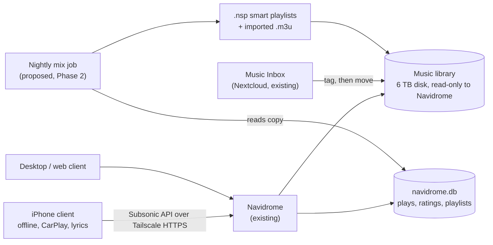

# Resonance

A self-hosted personal music experience built on the Navidrome server already running in this
homelab: Apple Music polish on the phone, Spotify-style personal mixes, SoundCloud-style
exploration, with private anywhere-access over Tailscale.

Resonance is a layer, not a new server. It reuses Navidrome (library, streaming, smart
playlists, scrobbling), an existing iPhone client (Amperfy, proposed), Nextcloud (file
inbox), Lidarr (library naming) and Tailscale (access). It adds only small, optional pieces:
smart-playlist rules, a playlist matcher, and a nightly mix job.

| File | Purpose |
|---|---|
| [AUDIT.md](AUDIT.md) | Read-only audit: verified facts, compatibility matrix |
| [UPGRADE_2_PLAN.md](UPGRADE_2_PLAN.md) | Upgrade 2.0: organization, intake pipeline, playlist import, discovery |
| [PROJECT_GOAL.md](PROJECT_GOAL.md) | Product objectives |
| [ARCHITECTURE.md](ARCHITECTURE.md) | Current and proposed components |
| [ROADMAP.md](ROADMAP.md) | Phases, budgets, acceptance tests, risks, rollback |
| [DECISIONS.md](DECISIONS.md) | Decisions and reasons |
| [TESTING.md](TESTING.md) | Test plans and verified results |
| [HANDOFF.md](HANDOFF.md) | Progress and next-session context |
| [CLAUDE.md](CLAUDE.md) | Short instructions for AI sessions |
| [scripts/audit-readonly.sh](scripts/audit-readonly.sh) | Read-only server audit |

This repository is public: no addresses, tailnet names, credentials or library contents here.
