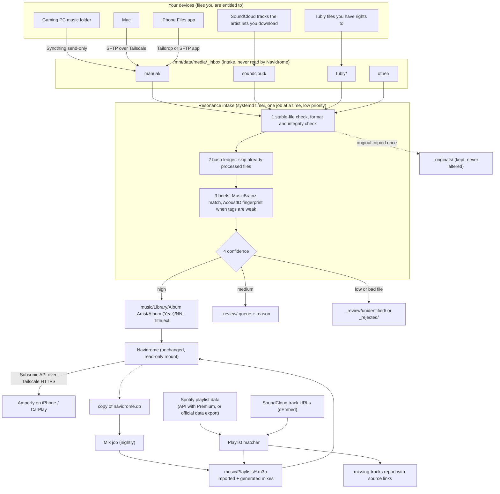

# Music System Upgrade 2.0: audit delta and plan (2026-10-30)

Scope: the owner's "Music System Upgrade 2.0" brief. Builds on AUDIT.md (live read-only audit,
2026-10-29). Nothing here is deployed. Labels: **VERIFIED** (seen live or in vendor docs),
**PENDING** (live re-check waiting on the server session), **PROPOSED**.

## 1. Audit delta

### Still true from 2026-10-29 (VERIFIED, re-check PENDING)

| Area | Finding |
|---|---|
| Navidrome | 0.64.2, `~/media-server/docker-compose.yml`, env-only config, library `/mnt/data/media/music` → `/music` **read-only**, DB in `~/media-server/config/navidrome` |
| Library | Empty on 2026-10-29: 0 songs, 0 playlists, 1 user |
| Intake | `/mnt/data/media/_inbox` created 2026-10-29, owner 1000 (outside the library) |
| Syncthing | Installed on the server and paired with the gaming PC; the PC side was not running |
| Resources | 4 cores, 7.5 GB RAM, **2.7 GB available, swap 2.4/4 GB in use**; music disk 1,122 GB free; system disk 22 GB free |
| Shared mounts | Jellyfin mounts `/mnt/data/media` rw; Lidarr mounts `/mnt/data` rw and is **stopped** |
| Backups | Daily cron `~/homelab/backup/backup.sh` incl. Navidrome config and DB, written to the media disk; no offsite copy |
| Integrations | No Last.fm, ListenBrainz, Spotify or SoundCloud configuration in Navidrome |
| Amperfy | Installed on the iPhone; no Amperfy client record in Navidrome yet |

### To re-check live (PENDING)

What arrived in `_inbox` (count, formats, size, tag completeness, integrity), Syncthing link
state, tagging tools already installed (beets, Picard, ffmpeg, chromaprint), any Spotify,
SoundCloud or downloader tools on the server, Amperfy client version once it connects,
filesystem snapshot support, current memory.

### New findings from research (VERIFIED, sources at the end)

| Topic | Finding | Consequence |
|---|---|---|
| Spotify Web API | Since 2026-02-11 (new apps) and 2026-03-09 (existing apps), Development Mode needs the app owner to have **Spotify Premium**, allows one Client ID per developer and 5 users. Recommendations, related artists and audio features were removed for Development Mode in Nov 2024 | Reading your own playlists is possible if you have Premium. Spotify recommendations and history are not available and are not planned |
| SoundCloud API | Self-serve app registration reopened in May 2026, **only for Artist Pro subscribers** (paid) | API access costs money: excluded unless you approve. Fallback below |
| Tubly | A YouTube video/MP3 downloader extension (freemium) | YouTube's terms forbid downloads except where YouTube or the rights holder allows it. The pipeline accepts Tubly files only as files you are entitled to; YouTube audio is lossy at source, so "320 kbps" files are not higher quality |
| AudioMuse-AI | Needs a 4-core AVX2 CPU, **8 GB RAM minimum**, PostgreSQL and Redis; analysis with Librosa | Too heavy for this server today (2.7 GB free). Revisit later, possibly running on the gaming PC against Navidrome's API |
| Amperfy | Release notes list "auto download latest songs" and a background library sync (v1.1.0); no source confirms that new tracks in a downloaded playlist download in the background | Must be tested on your phone; iOS limits background work, so nothing is promised |

## 2. Existing functionality that must stay unchanged

Navidrome's container, compose file, port, `tailscale serve` route, user account and
read-only music mount; Jellyfin, Lidarr (left stopped), Immich, Nextcloud, Minecraft and every
other container; the daily backup cron; Syncthing's existing pairing. Navidrome's internal
database is never written to; Resonance reads only a copy.

## 3. Architecture (PROPOSED)

### Folder layout (all on the existing media disk)

| Path | Purpose | Navidrome sees it |
|---|---|---|
| `/mnt/data/media/_inbox/{manual,soundcloud,tubly,other}/` | Intake | No |
| `/mnt/data/media/_originals/YYYY-MM/` | Byte-for-byte copies of every accepted file, kept | No |
| `/mnt/data/media/_review/` and `_review/unidentified/` | Medium and low confidence, with a reason file | No |
| `/mnt/data/media/_rejected/` | Broken, mislabelled or unsupported files, with a reason | No |
| `/mnt/data/media/music/Library/` | Organized library | Yes |
| `/mnt/data/media/music/Playlists/` | `.m3u` and `.nsp` files | Yes |
| `~/resonance/` | Config, scripts, beets database, hash ledger, logs, backups | No |

Library naming (beets `paths`):

- Albums: `Library/$albumartist/$album ($year)/$disc-$track - $title` (disc prefix only on multi-disc albums)
- Singles: `Library/$albumartist/Singles/$title`
- Compilations: `Library/Compilations/$album ($year)/$track - $artist - $title`
- Live, remix, clean/explicit and remaster versions keep their own release and title; they are never merged.

Genres are written as multi-value tags (primary first), never as folders.

## 4. Components and why

| Component | Choice | Why | Runs as |
|---|---|---|---|
| Organizer | **beets** (open source) in **copy** mode, `quiet` imports with `quiet_fallback: skip` | Mature MusicBrainz matcher with match distance to drive confidence; plugins cover the brief | One-shot Docker container or venv in `~/resonance`, started by the timer |
| Fingerprints | beets `chroma` (Chromaprint + AcoustID) only when tags are weak | Identifies untagged files; needs a free AcoustID API key (an account: your approval) | Same job |
| Genres | beets `lastgenre` with its canonical genre tree (genre + subgenre) | Uses Last.fm tag data, not filenames or artist names | Same job |
| Art, lyrics | `fetchart`, `embedart`, `lyrics` (LRCLIB) | Artwork and synced lyrics for Amperfy | Same job |
| Integrity | `ffprobe` decode check + `file --mime-type` | Rejects truncated or mislabelled files before import | Same job |
| Duplicates | Hash ledger + beets `duplicates` report (MBID + version-aware) | Report only, nothing deleted | Same job |
| Hard cases | MusicBrainz Picard on your PC or Mac | Interactive review of `_review/` | Desktop |
| Scan trigger | Navidrome's scan schedule, or the Subsonic `startScan` call | Native, no DB writes | — |
| Playlist matcher | Small Python script (standard library) | ISRC → MBID → title/artist/duration, writes `.m3u` + report | On demand |
| Mixes | Navidrome `.nsp` first, then a nightly Python job on a DB copy | Lightweight, explainable | systemd timer |
| Management UI | None at first: reports in `_review/` and a daily summary | Build a page only if this proves inadequate | — |

Not proposed: another music server, a database server, an AI model, a reverse proxy, AudioMuse-AI (for now), starting Lidarr (it would fight beets over the same files).

## 5. Integrations and their limits

**Spotify.** Two permitted routes, both read-only toward Spotify:
1. If you have Premium: a Development Mode app you own, scope `playlist-read-private`, reading your playlists' track names, artists, album, ISRC and duration. Token stored in a root-only file, never logged.
2. Without Premium: Spotify's own "Download your data" (Account → Privacy) includes your playlists as JSON. Slower (Spotify takes days) but needs no developer account.

Either feeds the same matcher. Recommendations and listening history from Spotify are not
used, both because the API no longer provides them to small apps and because the terms forbid
analysing Spotify content for this.

**SoundCloud.** No API without a paid Artist Pro plan. Workflow: you paste playlist or track
URLs into a text file; the matcher reads public metadata through SoundCloud's official oEmbed
endpoint (title and artist, no key), keeps the link and order, and reports each track as
*in library*, *awaiting review*, *available to import* (only if the artist enabled downloads,
which you do yourself in the browser into `_inbox/soundcloud/`), *unavailable locally* or
*unmatched*. Playlist URLs cannot be expanded to their tracks without the API, so playlists
need their track URLs listed.

**Tubly.** Treated only as a source of files on your PC. A Tubly download folder on the PC
syncs send-only to `_inbox/tubly/`. Because video titles make poor metadata, Tubly files always
go to review unless beets finds a strong MusicBrainz match. Use it only for audio you have the
right to download.

**Apple Music, YouTube Music.** Unchanged from AUDIT.md section 6 (file exports into the same matcher).

## 6. Discovery plan

| Playlist | How | Stage |
|---|---|---|
| Most Played, Recently Added, Forgotten Favorites, Favorite Genres | Navidrome `.nsp` | 1 (no code) |
| Hidden Gems | `.nsp`: loved or rated 4+, played at most once | 1 |
| New Artists | `.nsp`: added in last 30 days, never played | 1 |
| Daily Mix 1–3 | Nightly job: favorites, replay frequency, recency, genre clusters, at most 3 tracks per artist | 2 |
| Discover Weekly, Recommended for You | Nightly job: unplayed local tracks from similar artists (Last.fm similar-artist data, cached) | 2 |
| Similar Artists | Per-artist `.m3u` from cached artist relationships | 2 |
| New Releases | MusicBrainz release lookups for library artists (1 request per second); external suggestions list, not a playlist | 2 |
| Mood-based | Needs audio analysis; deferred (AudioMuse-AI too heavy now) | 3 |
| External discoveries | ListenBrainz weekly exploration if you enable scrobbling (public profile) | Optional |

Every generated playlist contains only local files. Each track carries a one-line reason in
the `.m3u` (`#EXTINF` comment) and in a daily report; outside suggestions go to a separate list.
Skips are not stored by Navidrome; the job infers them only if Amperfy's play reports allow it,
otherwise that signal is left out.

## 7. Amperfy and offline

| Layer | Who provides it | Status |
|---|---|---|
| Library metadata sync | Amperfy pulls from Navidrome | Test |
| Playlist sync | Amperfy downloads playlist contents | Test |
| Streaming cache | Amperfy | Test |
| Persistent offline downloads | Amperfy, manual per album or playlist | Test |
| Background download of new playlist tracks | Amperfy option "auto download latest songs" (v1.1.0 notes); iOS decides when background work runs | **Unverified; not promised** |

Fallback if background download does not work: one server-maintained playlist "Offline
Favorites" that changes only nightly; opening Amperfy on Wi-Fi and tapping download on that
playlist fetches only what is new.

## 8. Resource impact

| Component | RAM | CPU | Disk |
|---|---|---|---|
| Intake job (beets + ffprobe) | ~200–350 MB while running, 0 idle | 1 core at `nice 19` / `ionice idle`, 200 files per batch | beets DB < 100 MB per 10k tracks |
| Fingerprinting | +50 MB | ~1–2 s per file | — |
| `_originals` copy | — | — | equal to the music you import (fits in 1,122 GB free) |
| Mix job | < 150 MB for < 2 min nightly | low | < 50 MB cache |
| Docker image (if used) | — | — | ~0.3–0.5 GB on the system disk (22 GB free) |

Memory is the constraint: jobs run one at a time, at night or when the inbox changes, and are
capped with `MemoryMax=512M` in their systemd units.

## 9. Risks and mitigations

| Risk | Mitigation |
|---|---|
| Wrong match rewrites good tags | Copy mode only; strong-match threshold; medium and low go to review; originals kept |
| Partial files imported mid-sync | Stable for 2 minutes, no `.part`/`.crdownload`/Syncthing temp names, decode check |
| Duplicate albums | Hash ledger, MBID check, review queue |
| Lidarr started later and renames files | Leave Lidarr stopped, or point it elsewhere; documented |
| Backups lost with the disk | Copy `~/resonance` and Navidrome DB backups to the gaming PC via existing Syncthing (your approval) |
| Memory pressure | One job at a time, `MemoryMax`, nightly scheduling |
| Spotify app stops if Premium lapses | Data-export fallback |
| Over-recommending artists | Artist cap per mix, recency penalty |

## 10. Exact files and containers affected

New: `~/resonance/` (config, scripts, beets DB, ledger, logs), the `_inbox/*`, `_originals`,
`_review`, `_rejected` folders, `music/Library`, `music/Playlists`, two systemd units
(`resonance-intake.timer`, `resonance-mixes.timer`), optionally one Docker image for beets.

Changed only with separate approval: Navidrome compose env (`ND_BACKUP_*`, `ND_LASTFM_*`,
`ND_LISTENBRAINZ_*`). Not touched: every other container and compose file, Navidrome's DB, Syncthing pairing.

## 11. Implementation sequence and gates

| Phase | Work | Gate before the next phase |
|---|---|---|
| 0 | Finish the live audit delta | You approve this plan and the backup strategy |
| 1 | Backups: tar of `~/media-server` and a SQLite `.backup` of `navidrome.db`; restore test in a scratch container; create folders; read-only dry-run metadata report of `_inbox` | Restore works; report reviewed |
| 2 | Install beets (container or venv), config in `~/resonance`, run on a 1–3 album test set into a scratch library | Tags, paths, art, lyrics correct; originals unchanged (checksums) |
| 3 | Import the existing collection in batches of ~200 into `music/Library`; Navidrome scan | Each batch: counts match, no originals changed, Amperfy browses it |
| 4 | Intake timer for new files | Idempotency and interrupted-job tests pass |
| 5 | Playlist matcher (Spotify export or API, SoundCloud URLs, Tubly folder) | Match report checked by hand on 20 rows |
| 6 | `.nsp` playlists, then the mix job | Mixes regenerate, artist cap holds, reasons present |
| 7 | Amperfy tests on your phone and car (TESTING.md) | Results recorded; limitations documented |
| 8 | Performance, security review, docs | Resource numbers recorded |

Code lives in a new **private** GitHub repo `resonance` (DECISIONS D-008); creating it needs your OK.

## 12. First safe tasks (no production change)

1. Re-run the read-only audit once the server reconnects.
2. Write the beets config, intake script and matcher with unit tests in the private repo (or a branch here until you approve the repo).
3. Write the backup and restore script and its test (not run until approved).
4. Draft the starter `.nsp` files.

Waiting on you: approve the plan; approve the private repo; whether you have Spotify Premium; whether an AcoustID account is OK; where off-disk backups should go.

## Sources (read 2026-10-30)

- Spotify Development Mode changes: techcrunch.com/2026/02/06/spotify-changes-developer-mode-api-to-require-premium-accounts-limits-test-users/
- SoundCloud app registration: developers.soundcloud.com/docs/api/register-app
- Tubly: filehorse.com/download-tubly-downloader/
- AudioMuse-AI requirements: github.com/NeptuneHub/AudioMuse-AI
- Amperfy release notes v1.1.0: newreleases.io/project/github/BLeeEZ/amperfy/release/v1.1.0
